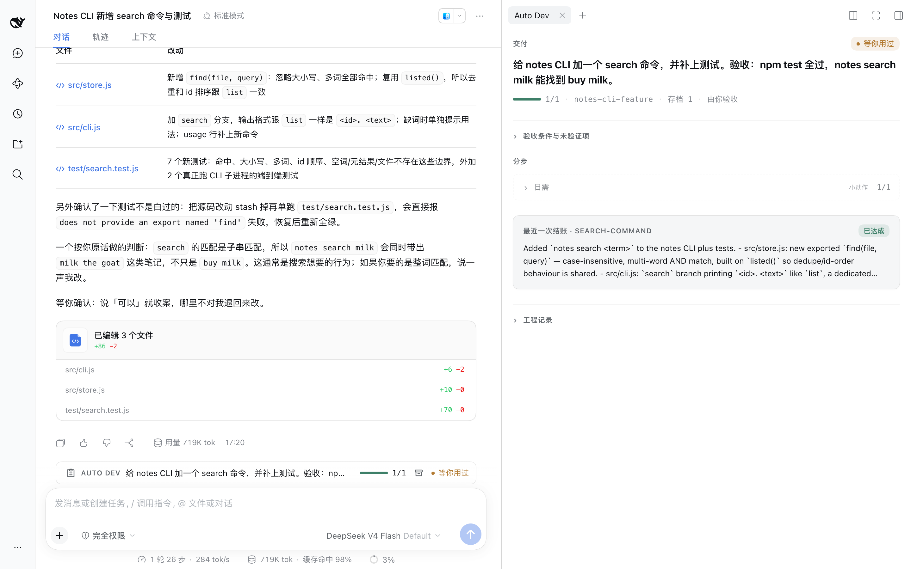
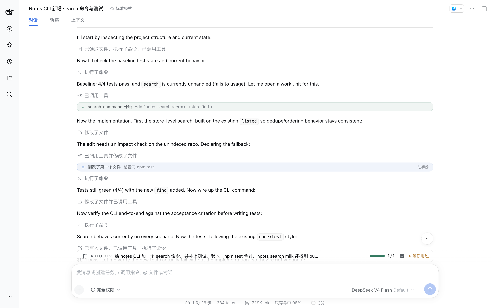

# dsh-auto-dev

**Your production-grade dev team for DeepSeek Harness.**

Vibe coding makes fast fashion: use it once, throw it away. dsh-auto-dev ships products you can launch and maintain.

[](LICENSE)

**English** · [简体中文](./README.zh-CN.md)

**Targets the Web UI of [DeepSeek Harness](https://github.com/deepseek-ai/deepseek-harness) 0.2.1-rc.1.**



## Why not just vibe code

### 1. Full-stack dev team: one request covers frontend, backend, database and tests
- **Vibe coding:** one model writes code; you babysit everything else.
- **dsh-auto-dev:** a whole dev team. Production-grade results, no coding skills required.

### 2. Test-driven delivery: a product you can launch, not a one-off demo
- **Vibe coding:** works in the demo, breaks on real data.
- **dsh-auto-dev:** best practices, fully tested, reproducible and stable.

### 3. Senior engineering playbook: senior experience, every time
- **Vibe coding:** quality depends on the model's mood that day.
- **dsh-auto-dev:** debugging, review, release, plus best practices for major languages and platforms — the right method for each situation.

### 4. Cross-session task state: days of work, many chats, nothing lost
- **Vibe coding:** long chats forget; every new chat starts from zero.
- **dsh-auto-dev:** switch chats, come back tomorrow, hand it to a teammate — pick up where you left off.

### 5. Dev progress UI: see where things stand, skip the essays
- **Vibe coding:** scroll through hundreds of lines to guess how far it got.
- **dsh-auto-dev:** one board — what's done, what's left, what's waiting on you.

### 6. Project knowledge base: it gets to know your project
- **Vibe coding:** every chat is a first meeting; the same pitfall, ten times.
- **dsh-auto-dev:** pitfalls, environment and business rules are recorded automatically and reused next time.

### 7. Requirement clarification: it asks before it guesses
- **Vibe coding:** starts on a one-liner, builds the wrong thing.
- **dsh-auto-dev:** asks two or three questions on business-critical points; decides technical details itself.

### 8. Rolling Git checkpoints: save before every boss fight
- **Vibe coding:** one slip and your code is gone.
- **dsh-auto-dev:** saves before big changes and after tests pass; roll back anytime. Deleting data or deploying always asks you first.

## Install

```sh
git clone https://github.com/plyflai/dsh-auto-dev.git
dsh plugin --profile <profile> add ./dsh-auto-dev
```

Restart DSH afterwards. No runtime dependencies; works out of the box.

## Quick start

In any chat, start with `/dsh-auto-dev` and say what you want:

```
/dsh-auto-dev add a search command to the notes CLI. Done when `notes search milk` finds "buy milk".
```

That's it. Planning, coding, testing and delivery are on it; when a decision is yours, it stops and asks.

Continuing tomorrow in a new chat:

```
/dsh-auto-dev adopt
```

Chats that never use `/dsh-auto-dev` are left completely alone.

## Dev progress UI



- **Receipts**: a card in the chat at every milestone — started, unit done, blocked, waiting for you, delivered.
- **Dock**: one line above the input — how far the task is and whether it needs you.
- **Board**: the *Auto Dev* right panel — goal, acceptance criteria, what is still unverified, the latest result, the engineering log.

## Commands

| Command | |
| --- | --- |
| `start <request>` | Start work, or pick up this project's unfinished task |
| `new <request>` | Always open a new task |
| `status` | Current task, progress, what is pending |
| `tasks` | Recent tasks in this project |
| `adopt [taskId]` | Continue a task from another chat |
| `pause` · `resume` · `cancel` | Change the task's state |
| `organize` | Propose a cleanup of a long plan; nothing changes until you agree |
| `plan` · `help` | How to begin |

All are `/dsh-auto-dev <command>`; plain text after `/dsh-auto-dev` means `start`.

## Project knowledge base

Kept in your project's `.auto-dev/` as plain files you can read and edit:

| File | What it holds |
| --- | --- |
| `memory.json` | Pitfalls: root causes and fixes |
| `runtime.json` | Environment: observed facts, with source and expiry |
| `project-domain.md` | Business rules: terms and decisions you made |

Commit them to share with your team, or add `.auto-dev/` to `.gitignore`. Task progress lives in DSH's own storage.

## Checkpoints and rollback

- Checkpoints are Git-based (under `refs/dsh-auto-dev/`) and never move your HEAD, branch or index. Background checkpoints keep the latest 5; the ones around milestones are kept.
- Rollback restores Git-tracked files only, and every rollback needs your explicit OK. Untracked files, databases and running services are not covered.
- Recursive deletes, history rewrites, deploys and destructive SQL run only with your OK for that task and that action.

## For developers

In chats that opted in, the model gets seven tools:

| Tool | Purpose |
| --- | --- |
| `work_start` | Register your request verbatim, with scope and acceptance criteria |
| `work_plan` | Optional units, dependencies and grouping |
| `work_submit` | Hand in a result tied to real executions from this session |
| `work_status` | Read the task, its executions and the board |
| `work_control` | Pause, accept, rework, hand off, checkpoints, notes |
| `work_extend` | Record a decision you made, bound to one task and one action |
| `work_env` | Facts about the environment, with their source |

The engineering playbook lives in [skills/auto-dev](skills/auto-dev/SKILL.md).

Local development needs Node.js ≥ 20:

```sh
npm install
npm run check          # unit tests + end-to-end scenarios against the real plugin
npm run build:client   # rebuild lib/client.js after editing src/client.js
npm run hooks:install  # run the check before every commit
```

Host-side changes need a DSH restart; client changes need a page refresh.

## License

[MIT](LICENSE)
