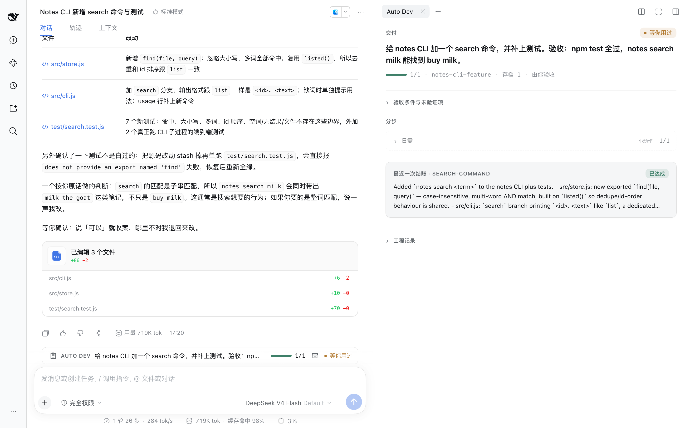
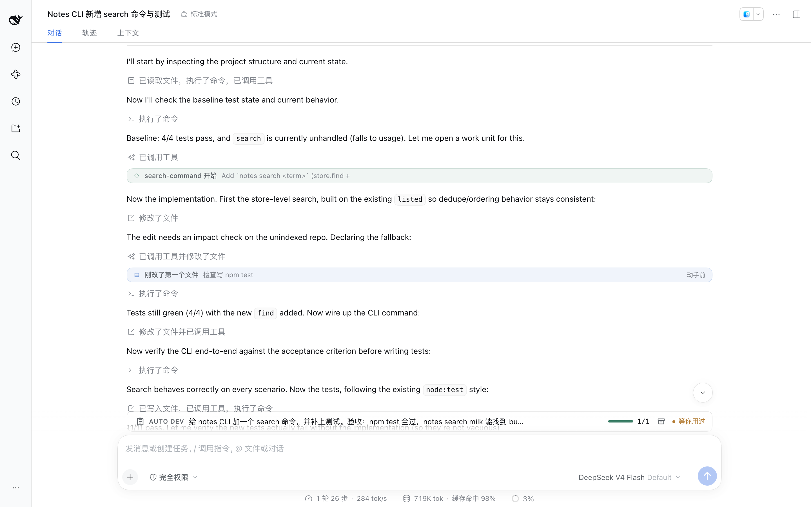

# dsh-auto-dev

**你的 DSH 生产级代码开发团队。**

vibe coding 做出来的是用完就扔的快销品，dsh-auto-dev 交付的是能上线、能维护的产品。

[](LICENSE)

[English](./README.md) · **简体中文**

**适配 [DeepSeek Harness](https://github.com/deepseek-ai/deepseek-harness) 0.2.1-rc.1 的 Web 界面。**



## 为什么不直接 vibe coding

### 1. 全栈开发团队：一句话需求，前后端、数据库到测试全包
- **vibe coding：** 只有一个写代码的模型，剩下的全靠你盯。
- **dsh-auto-dev：** 一整支开发团队，不懂代码也能拿到生产级成果。

### 2. 测试驱动交付：能上线的产品，不是一次性 demo
- **vibe coding：** 演示能跑，换个数据就崩。
- **dsh-auto-dev：** 最佳实践、全部过测试，可复现、表现稳定。

### 3. 资深工程方法库：资深工程师的经验，每次都在
- **vibe coding：** 写得好不好，全看 AI 当次发挥。
- **dsh-auto-dev：** 排障、评审、发布，以及主流语言和平台的最佳实践，遇到什么用什么。

### 4. 跨会话任务状态：做几天、换几个对话，进度不丢
- **vibe coding：** 对话一长就失忆，新对话从头讲。
- **dsh-auto-dev：** 换对话、隔天再来、换人接手，都能接着干。

### 5. 专属开发进程 UI：进度一眼看懂，不读长篇大论
- **vibe coding：** 想知道做到哪了，得翻几百行对话。
- **dsh-auto-dev：** 看板上就是：做完了什么、还差什么、在等你拍什么板。

### 6. 项目知识库：越用越懂你的项目
- **vibe coding：** 每次都是第一次见面，同一个坑踩十遍。
- **dsh-auto-dev：** 踩过的坑、项目环境、业务规则自动记下，下次直接用。

### 7. 需求澄清：需求不清先问你，不瞎猜
- **vibe coding：** 拿到一句话就开干，做完才发现不是你要的。
- **dsh-auto-dev：** 关键业务先问两三个问题，技术细节它自己定。

### 8. 滚动式 Git 存档：像打 boss 一样，大战前后自动存档
- **vibe coding：** AI 一手滑，代码就没了。
- **dsh-auto-dev：** 重大改动前、测试通过后自动存档，改坏随时回退；删库、部署一定先问你。

## 安装

```sh
git clone https://github.com/plyflai/dsh-auto-dev.git
dsh plugin --profile <profile> add ./dsh-auto-dev
```

装完重启 DSH。没有运行时依赖，开箱即用。

## 上手

在任意会话里，用 `/dsh-auto-dev` 开头说你要什么：

```
/dsh-auto-dev 给 notes CLI 加一个 search 命令。验收：notes search milk 能找到 buy milk。
```

就这一句。剩下的拆计划、写代码、跑测试、交付，都由它来；需要你拍板时，它会停下来问你。

明天换个对话想接着做：

```
/dsh-auto-dev adopt
```

没用过 `/dsh-auto-dev` 的会话完全不受影响。

## 开发进程 UI



- **回执**：对话里每个关键节点一张卡片——开工、单元完成、受阻、等你决定、已交付。
- **Dock**：输入框上方一行，当前任务做到哪、要不要你。
- **看板**：右侧面板 *Auto Dev*，目标、验收条件、还没验证的地方、最近一次结果、工程记录。

## 命令

| 命令 | |
| --- | --- |
| `start <需求>` | 开工；这个项目有没做完的任务时先接手它 |
| `new <需求>` | 一定另开新任务 |
| `status` | 当前任务、进度、待你处理的事 |
| `tasks` | 这个项目最近的任务 |
| `adopt [taskId]` | 接手别的对话里的任务 |
| `pause` · `resume` · `cancel` | 暂停、继续、取消 |
| `organize` | 给长计划提一份整理方案；你点头前什么都不改 |
| `plan` · `help` | 怎么开始 |

都写成 `/dsh-auto-dev <命令>`；后面直接跟话等于 `start`。

## 项目知识库

记在你项目的 `.auto-dev/` 里，纯文件，可读可改：

| 文件 | 记什么 |
| --- | --- |
| `memory.json` | 踩过的坑：根因与修法 |
| `runtime.json` | 项目环境：观察到的事实，带来源与有效期 |
| `project-domain.md` | 业务规则：术语与你做过的决定 |

想让团队共享就提交进仓库；不想就加进 `.gitignore`。任务进度存在 DSH 自己的存储里。

## 存档与回退

- 存档基于 Git（`refs/dsh-auto-dev/` 下），不动你的 HEAD、分支和暂存区；后台存档滚动保留最近 5 份，重大节点前后的存档单独保留。
- 回退只恢复 Git 跟踪的文件，每次都要你明确同意。未跟踪文件、数据库、正在跑的服务不在存档范围内。
- 递归删除、改写历史、部署、破坏性 SQL 这类操作，必须有你针对这次任务、这个动作的同意才会执行。

## 给开发者

模型在启用的会话里拿到七个工具：

| 工具 | 用途 |
| --- | --- |
| `work_start` | 按原话登记需求，写明范围与验收 |
| `work_plan` | 可选的单元、依赖与分组 |
| `work_submit` | 提交结果，绑定本会话里真实跑过的命令 |
| `work_status` | 读任务、执行记录与看板 |
| `work_control` | 暂停、验收、返工、交接、存档点、记录 |
| `work_extend` | 记下你做的决定，绑定到具体任务与动作 |
| `work_env` | 有来源的环境事实 |

工程方法库见 [skills/auto-dev](skills/auto-dev/SKILL.md)。

本地开发需要 Node.js ≥ 20：

```sh
npm install
npm run check          # 单元测试 + 真实插件上的端到端场景
npm run build:client   # 改了 src/client.js 后重建 lib/client.js
npm run hooks:install  # 每次提交前自动跑检查
```

改宿主侧代码要重启 DSH；改客户端刷新页面即可。

## 许可

[MIT](LICENSE)
